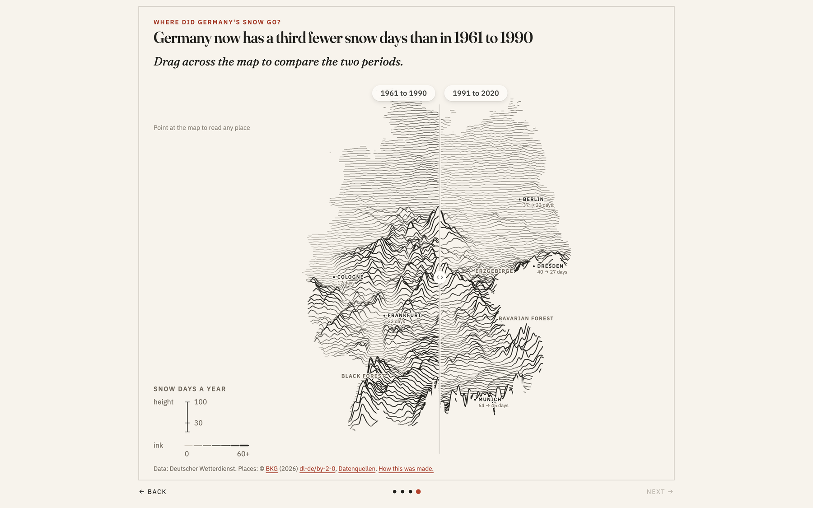

# Where did Germany's snow go?

Seventy-five years of snow in Germany, drawn as lines. Data: Deutscher Wetterdienst, 1 km grids of snow cover days, 1951 to 2025.

## Open it

- [The map](https://chiragsomashekar.github.io/snow-lines/), in four steps. Point at it, or tap on a phone, to read any place.
- [How this was made](https://chiragsomashekar.github.io/snow-lines/?method)

## Good to know

- A snow day is a morning with at least 1 cm of snow on the ground.
- One line every 6 km, north to south. More snow days: higher and darker.
- Each period is thirty years, averaged. 1961 to 1990 and 1991 to 2020 are the periods the World Meteorological Organization uses.
- The lines are smoothed. The numbers are not.
- [The notebook](notebooks/the-data.ipynb) goes through the data step by step. [METHODOLOGY.md](METHODOLOGY.md) has the sources and how the map is made.

## Built with

React, D3 and Motion. Python for the data.

## Data

Deutscher Wetterdienst, Climate Data Center. Annual 1 km grids of snow cover days. Open data, [CC BY 4.0](https://creativecommons.org/licenses/by/4.0/).

Place positions: © [BKG](https://www.bkg.bund.de) (2026) [dl-de/by-2-0](https://www.govdata.de/dl-de/by-2-0), [Datenquellen](https://sgx.geodatenzentrum.de/web_public/gdz/datenquellen/datenquellen_gn250.pdf). From the Geographische Namen 1:250 000 (GN250), converted to DWD's grid.

The code is MIT.
